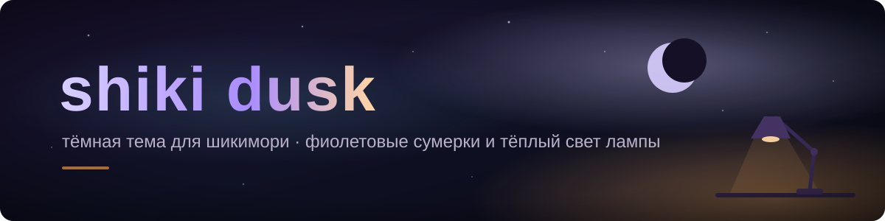
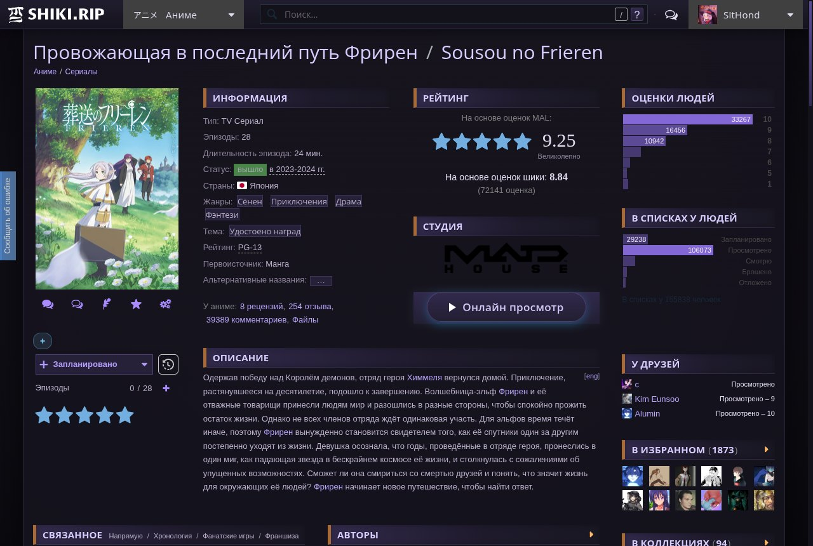
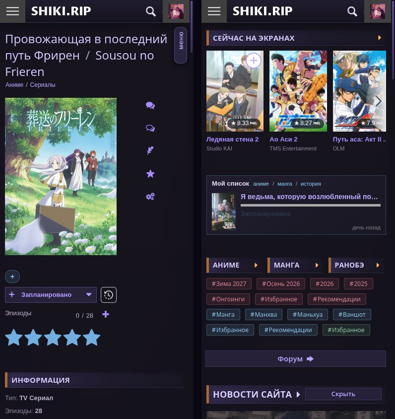
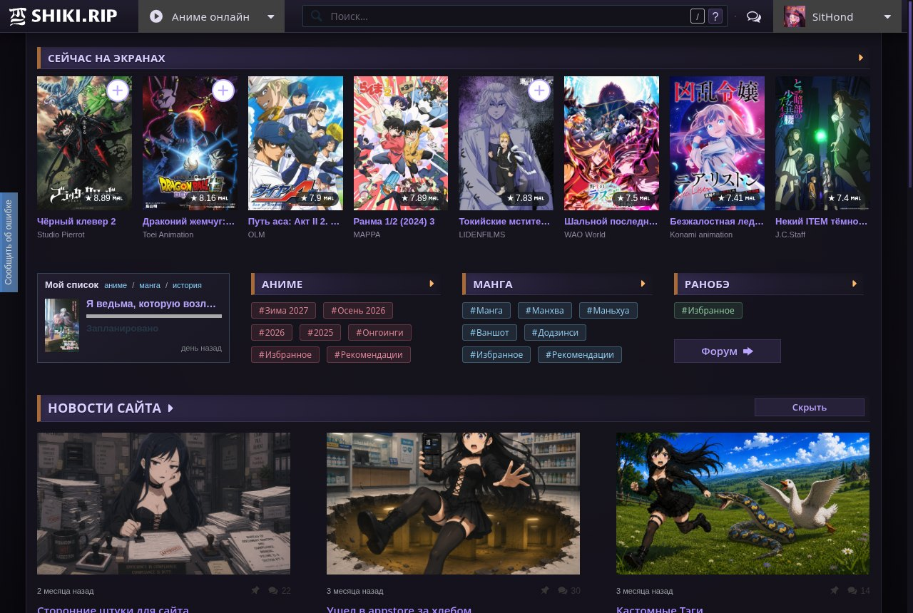
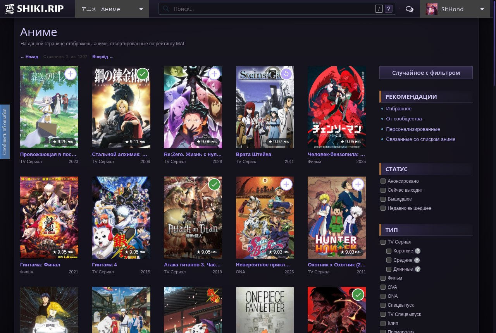
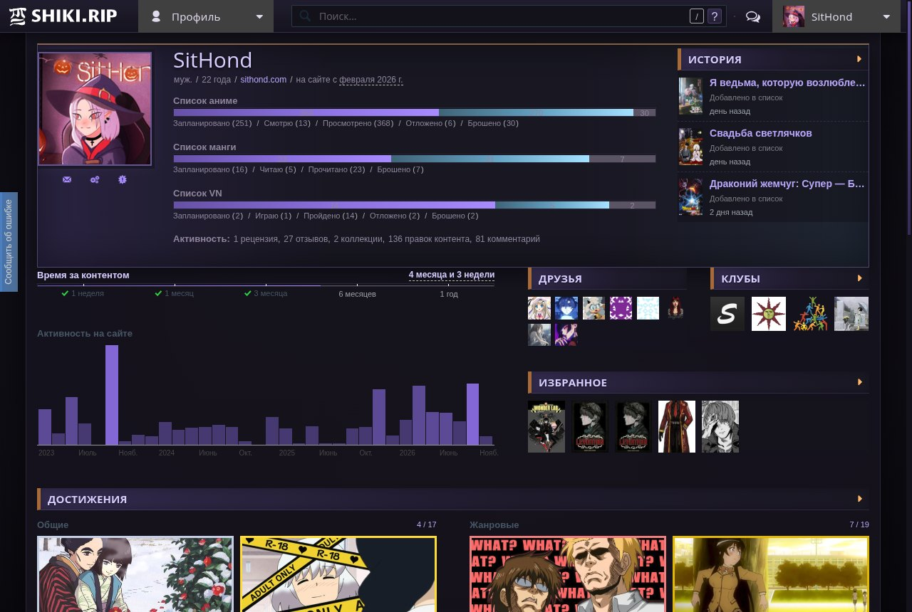
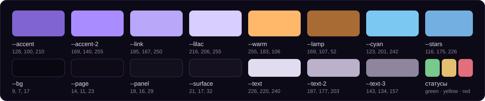
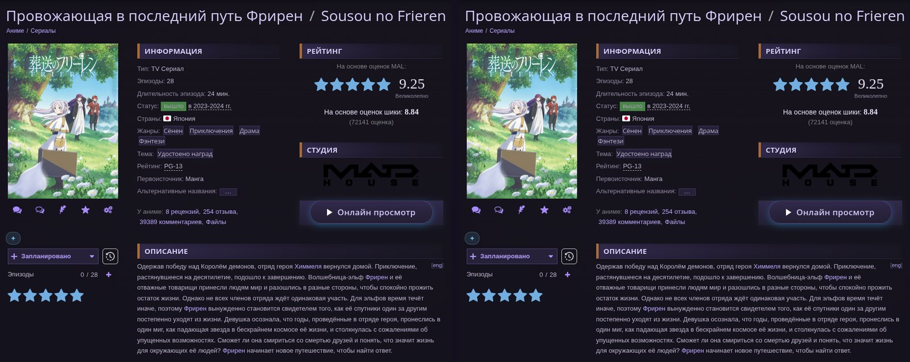

<p align="center">
  
</p>

<p align="center">
  <a href="https://github.com/SitHond/shikimori-theme-dusk/releases/latest"></a>
  <a href="https://github.com/SitHond/shikimori-theme-dusk/actions/workflows/check.yml"></a>
  
</p>

Тёмная тема для [ShikiRIP](https://shiki.rip) и [Shiki](https://shikimori.io): фиолетовые сумерки, тёплый свет лампы под курсором и холодные голубые акценты. Работает на компьютере и на телефоне, ставится одним стилем в «Внешний вид сайта». Текущая версия — **v0.3.1**.

<table>
  <tr>
    <td valign="top"></td>
    <td valign="top" width="300"></td>
  </tr>
</table>

| Главная | Каталог с фильтрами |
| --- | --- |
|  |  |



## Что внутри

- **Сумеречный фон.** Мягкие пятна лунного, голубого и тёплого света, виньетка по краям. Можно поставить свои обои.
- **Тёплое наведение.** Ссылки, кнопки и теги под курсором загораются цветом лампы. На телефоне отклик появляется при нажатии.
- **Без светлых пятен.** Перекрашены меню, поиск, окна, подсказки, редактор, плеер, фильтры каталога, списки, профиль и главная, в том числе блоки, которые есть только на ShikiRIP.
- **Телефон.** Все цвета работают на любой ширине экрана, не только на широком.
- **Одна палитра.** Около двадцати цветов, остальные оттенки тема считает сама. Поменяйте `--accent`, и перекрасится всё фиолетовое.

## Установка

1. Откройте профиль → «Настройки» → «Внешний вид сайта».
2. Откройте файл [site.css](https://github.com/SitHond/shikimori-theme-dusk/blob/v0.3.1/site.css), скопируйте его **целиком** (кнопка копирования справа над кодом) и вставьте в поле стиля вместо того, что там было.
3. Нажмите «Сохранить» и обновите страницу (Ctrl+Shift+R; на телефоне — обновление без кеша, если оно есть).

Главное в site.css — две строки подключения и блок «Палитра»:

```css
@import url("https://css-club.web.app/css/CodeMirror_dark.css");
@import url("https://raw.githubusercontent.com/SitHond/shikimori-theme-dusk/v0.3.1/css/part_01.css");
```

### Обновление

Когда выйдет новая версия, замените в строке `@import` номер `v0.3.1` на новый со страницы [Releases](https://github.com/SitHond/shikimori-theme-dusk/releases). Свою палитру, если вы её меняли, трогать не нужно.

## Палитра



Цвета меняются в блоке «Палитра» в конце вашего стиля (он пришёл вместе с site.css). Каждый цвет — три числа R, G, B через запятую, например `128, 100, 210`. Подобрать цвет и узнать его числа можно в любом color picker.

Первые две строки блока (`@media` и `html:root`) не удаляйте: без них сайт применит цвета только на широких экранах, и телефон останется без них.

| Строка | Что меняет |
| --- | --- |
| `--accent` | главный фиолетовый: кнопки, подсветка строк, выделение |
| `--accent-2` | светлый фиолетовый: значки, ники, названия аниме и новостей |
| `--link` | ссылки |
| `--lilac` | заголовки |
| `--warm` / `--warm-2` | ссылки и кнопки под курсором — «свет лампы» |
| `--lamp` | тёплая полоска слева у заголовков блоков |
| `--cyan` | фокус полей, отметки, вторая шкала |
| `--bg` / `--page` | фон под страницей / колонка страницы |
| `--panel` / `--surface` | выпадающие списки и поиск / окна и подсказки |
| `--bg-image` | свои обои: `url("https://…/картинка.jpg");` или `none` |
| `--bg-dim` | затемнение обоев: `0` — яркие, `1` — совсем тёмные |
| `--text` / `--text-2` / `--text-3` | основной, второстепенный и приглушённый текст |

### Пример: морская ночь

Вставьте этот блок в самый конец стиля (или замените им значения в «Палитре»). Слева — тема как есть, справа — с этим примером.

```css
@media screen and (min-width: 1px) {
  html:root {
    --accent: 46, 150, 140;
    --accent-2: 96, 210, 190;
    --link: 120, 214, 200;
    --lilac: 200, 240, 232;
    --warm: 255, 196, 120;
    --lamp: 190, 130, 60;

    --bg: 6, 14, 16;
    --page: 9, 19, 22;
    --panel: 12, 24, 28;
    --panel-2: 15, 30, 35;
    --surface: 14, 27, 31;
    --field: 8, 18, 21;
    --deep: 6, 13, 15;
    --line-tint: 140, 220, 205;

    --text: 220, 238, 234;
    --text-2: 170, 196, 190;
    --text-3: 120, 146, 140;
  }
}
```



### Свои обои

```css
@media screen and (min-width: 1px) {
  html:root {
    --bg-image: url("https://example.com/wallpaper.jpg");
    --bg-dim: .6;
  }
}
```

В ссылке на картинку не должно быть символа `@`, иначе сайт её вырежет. Если текст плохо читается, увеличьте `--bg-dim`.

## Если что-то пошло не так

**Тема не загрузилась или осталась старая.** Обновите страницу с очисткой кеша (Ctrl+Shift+R). Если сайт пишет «Не удалось импортировать», откройте [сброс кеша стилей](https://shikimori.io/tests/reset_styles_cache), вставьте туда ссылку из сообщения, сохраните стиль ещё раз и обновите страницу.

**На телефоне цвета не изменились, а на компьютере всё в порядке.** Проверьте, что вокруг ваших настроек остались строки `@media screen and (min-width: 1px)` и `html:root`, как в примерах.

**Где-то осталось светлое пятно.** Создайте [issue](https://github.com/SitHond/shikimori-theme-dusk/issues) со скриншотом и ссылкой на страницу — поправим в следующей версии.

## Для разработчиков

Тема собрана из модулей в `src/`: `python3 tools/build.py` склеивает их в `css/part_NN.css`, а `python3 tools/quick_check.py` проверяет результат на фильтре сайта. Релизы выпускает GitHub Actions по тегу `vX.Y.Z`. Подробности — в [AGENTS.md](AGENTS.md) и [docs/ARCHITECTURE.md](docs/ARCHITECTURE.md).

## Благодарности

Устройство репозитория — модули, сборка частями и эмуляция фильтра сайта — повторяет тему [shiki glass](https://github.com/Hikisey/shikimori-theme) от [Hikisey](https://github.com/Hikisey).
